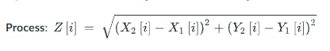
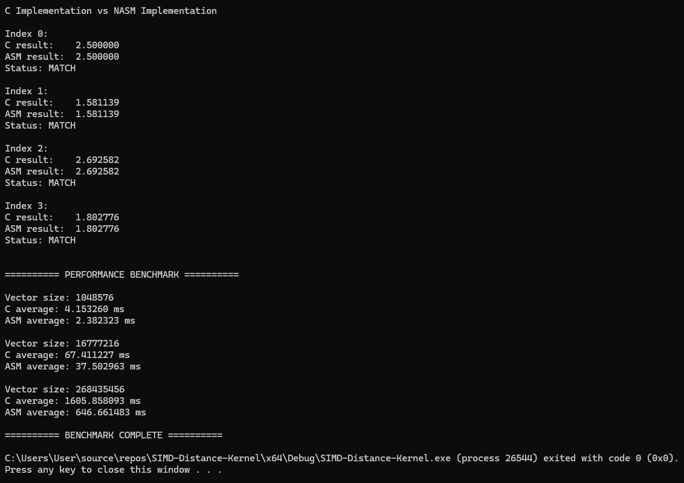
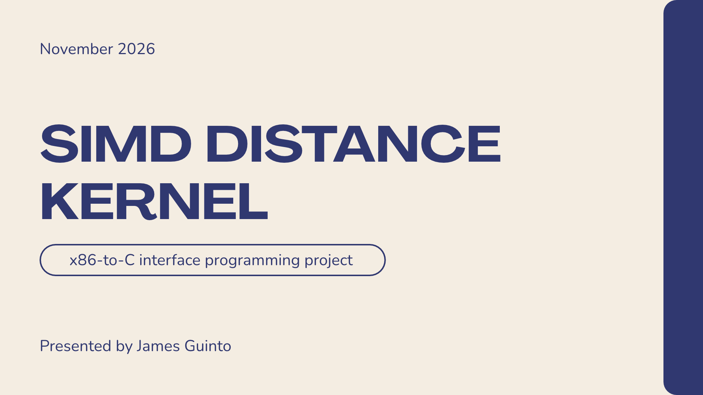

# SIMD Distance Kernel: C and x86-64 Assembly Performance Comparison

**Submitted by:** James Ryan K. Guinto of S30E


## 1. Introduction

This programming project implements and evaluates a Euclidean distance kernel between the coordinate points across two vectors using two approaches which are the C language and x86-64 Assembly using NASM.

The purpose is to calculate the distance between corresponding points in a two-dimensional coordinate system. Both implementations perform the same mathematical operation and uses the same formula, which allows for execution and execution performance comparisons.

The Assembly implementation uses scalar SIMD instructions to perform floating-point calculations.

## 2. Project Objectives

- Implement the Euclidean distance calculation using C.
- Implement the same Euclidean distance calculation using x86-64 Assembly and NASM.
- Verify that both implementations produce matching results.
- Measure execution time using different vector sizes.
- Compare the performance of both implementations.

## 3. Mathematical Formula

The Euclidean distance between two points is calculated using:



Which is used by the kernel during calculations for each array index \(i\).
The resulting distance is stored in the output array `z`.

## 4. Project Structure

```text
SIMD-Distance-Kernel/
│
├── SIMD-Distance-Kernel.slnx
├── images/
├── .gitignore
├── README.md
│
└── SIMD-Distance-Kernel/
    ├── main.c
    ├── kernel.h
    ├── kernel_c.c
    ├── kernel_asm.asm
    ├── SIMD-Distance-Kernel.vcxproj
    └── SIMD-Distance-Kernel.vcxproj.filters
```

### File Descriptions

| File | Description |
|---|---|
| `main.c` | Performs correctness testing and performance benchmarking. |
| `kernel.h` | Contains function declarations for both C and Assembly implementations. |
| `kernel_c.c` | Implements the Euclidean distance calculation in C. |
| `kernel_asm.asm` | Implements the Euclidean distance calculation in x86-64 Assembly and scalar SIMD instructions. |
| `.slnx` | Visual Studio solution file. |
| `.vcxproj` | Visual Studio project configuration. |


## 5. Implementation

### 5.1 C Implementation

The C implementation uses a loop to process each element of the input arrays. It calculates the differences between the corresponding X and Y coordinates, squares the differences, adds them together, and obtains the square root using the `sqrt()` function from the C math library.

### 5.2 x86-64 Assembly Implementation

The Assembly implementation of the euclidean distance calculation uses NASM syntax and scalar SSE2 instructions for double-precision floating-point calculations.

| Instruction | Purpose |
|---|---|
| `MOVSD` | Moves a scalar double-precision value. |
| `SUBSD` | Subtracts scalar double-precision values. |
| `MULSD` | Multiplies scalar double-precision values. |
| `ADDSD` | Adds scalar double-precision values. |
| `SQRTSD` | Calculates the square root of a scalar value. |

The XMM registers are used to perform the floating-point calculations. The Assembly function processes the arrays using a loop and stores each calculated distance in the output array.

### 5.3 CMD Output



## 6. Correctness Testing

Both implementations were tested using the sample input values provided in the project specifications.

### Correctness Test Results

| Index | C Result | ASM Result | Status |
|---:|---:|---:|---|
| 0 | 2.500000 | 2.500000 | MATCH |
| 1 | 1.581139 | 1.581139 | MATCH |
| 2 | 2.692582 | 2.692582 | MATCH |
| 3 | 1.802776 | 1.802776 | MATCH |

All four results matched between the C and Assembly implementations, confirming that both implementations produced equivalent results for the sample inputs.
## 7. Benchmark Methodology

The performance of both implementations was measured using Windows' `QueryPerformanceCounter()` high-resolution timer.

The benchmarking procedure consisted of:

1. Allocating memory for four input arrays and one output array.
2. Initializing the input arrays with test values.
3. Performing one warm-up execution before measurement.
4. Executing each kernel 30 times.
5. Measuring the execution time of each kernel call.
6. Calculating the average execution time across the 30 measured executions.

### Tested Vector Sizes

| Vector Size | Number of Elements |
|---|---:|
| 2^20 | 1,048,576 |
| 2^24 | 16,777,216 |
| 2^28 | 268,435,456 |

Note: The original 2^30 test size requirement was reduced to 2^28 because of the memory limitations of the device used.

## 8. Benchmark Results

The following table presents the measured average execution times.

| Vector Size | C Average (ms) | ASM Average (ms) |
|---|---:|---:|
| 2^20 | 4.153260 | 2.382323 |
| 2^24 | 67.411227 | 37.502963 |
| 2^28 | 1605.858093 | 646.661483 |

### 8.1 Performance Comparison

The speedup is calculated by dividing the C execution time by the Assembly execution time.

       Speedup = C Execution Time / ASM Execution Time

The percentage reduction in execution time is calculated using:

       Improvement = [(C Time - ASM Time) / C Time] x 100
    
| Vector Size | ASM Speedup | Time Reduction |
|---|---:|---:|
| 2^20 | 1.74× | 42.64% |
| 2^24 | 1.80× | 44.37% |
| 2^28 | 2.48× | 59.73% |

## 9. Performance Analysis

Based on the benchmark results, the Assembly implementation consistently achieved lower average execution times than the C implementation across all three tested vector sizes.

For the smallest vector size, 2^20, the Assembly implementation achieved a speedup of approximately 1.74 times, reducing execution time by 42.64%. At 2^24, its speedup increased to approximately 1.80 times, with a 44.37% reduction in execution time.

The largest test, 2^28, showed the greatest performance improvement. The Assembly implementation completed the computation in approximately 646.66 milliseconds, compared with 1605.86 milliseconds for C. This resulted in a speedup of approximately 2.48 times and a 59.73% reduction in execution time.

These results indicate that the Assembly implementation performed better across all tested workloads, with a greater performance advantage observed at vector sizes increase. However, the results are specific to the tested computer which in my case uses 16gb of memory, compiler configuration, and execution environment. Therefore, this does not establish that Assembly will always outperform optimized C code as there are various technical configurations and settings where these tests can also be done.

## 10. Conclusion

The project successfully implemented and achieved its objective of calculating the Euclidean distance kernel in both C and x86-64 Assembly using NASM.

Correctness testing confirmed that both implementations generated matching results for all four sample inputs, demonstrating that the Assembly implementation correctly performed the same computation as the C implementation.

Performance benchmarking showed that the Assembly implementation achieved lower average execution times across all three tested vector sizes. Its greatest measured improvement occurred at 2^28, where it achieved a speedup of approximately 2.48 times and reduced execution time by 59.73% compared with the C implementation.

Overall, this project demonstrated the application of low-level Assembly instructions in performing mathematical computations and the importance of benchmarking in comparing different implementations of the same algorithm. The results showed that the Assembly implementation delivered better performance across the tested workloads.

## 11. Video Demo

[](https://www.youtube.com/watch?v=TDQS-08a-FU)
Click this thumbnail to access the full video.
